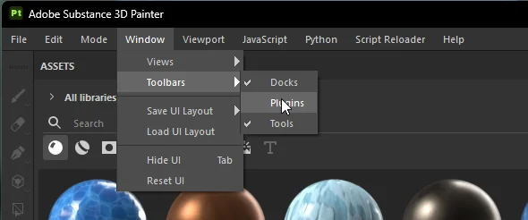

# Blender to Substance Painter (and back) GOB - Bridge
These scripts will allow you to export from Blender to Substance Painter and vice versa

## Updates are hosted here: https://files.devalt.cloud/blender-to-substance-painter-and-back-gob

Current version is 1.1.0. Download `gob_blender_1.1.0.zip` and `gob_sp_1.1.0.zip` from this repo or from [Releases](https://github.com/CIoudGuy/Blender-to-Substance-Painter-and-back-Gob/releases/latest).

Make sure to install both of them, and keep them on the same version (1.1.0 and 1.0.0 can't talk to each other).

---

## Features
- Automatically does your texture nodes in `Blender`
- Automatically sends your high poly in the bake box in `Substance Painter`
- Automatically sends your cage in the cage box in `Substance Painter`
- Export Textures/Meshes from Painter to Blender with 2 clicks
- Save your export presets `(SP)`
- UDIM Support
- and many more

**Tested on:** *Windows 11 / Blender 4.2, 4.5, 5.0 and 5.2 / Substance Painter v12.1.5*
**Not tested on:** *macOS / Linux (support was improved, please report any bugs)*

### PLEASE REPORT ANY BUGS YOU FIND ⚠️

---

## Installation

### Blender
Edit > Preferences > Add-ons > Install from Disk > Select `gob_blender_1.1.0.zip` > Done

### Substance Painter
The Painter plugin is now a `gob_sp` folder instead of a single .py file.

At the top bar hit Python > Plugins Folder > Unzip `gob_sp_1.1.0.zip` there so the `gob_sp` folder sits inside the plugins folder > Go back to Substance Painter > Reload Plugins Folder > Enable it from the Python Button in Substance > Done

## To update
Install the new version of **both** the Blender Addon and the Substance Painter plugin. Installing 1.1.0 over 1.0.0 cleans up the old files, and existing 1.0 projects keep working.

**Coming from 1.0.0: restart Blender after installing 1.1.0**, then make sure the add-on is ticked in Preferences > Add-ons. Blender keeps 1.0 loaded until it restarts.

For future updates, check https://files.devalt.cloud/blender-to-substance-painter-and-back-gob

---

## Troubleshooting
> A menu appeared on the side in Substance Painter, how do I remove it?

Go to Window > Toolbars > Disable Plugins

> Installing gives `[WinError 2] The system cannot find the file specified: ...\addons\gob_bl.py`

This happens when 1.0.0 was removed or replaced while Blender was still open: Blender still has the old 1.0 add-on in memory. Close Blender completely, open it again, then go to Edit > Preferences > Add-ons and tick GoB (install `gob_blender_1.1.0.zip` again if it isn't listed). Nothing needs to be deleted by hand.
